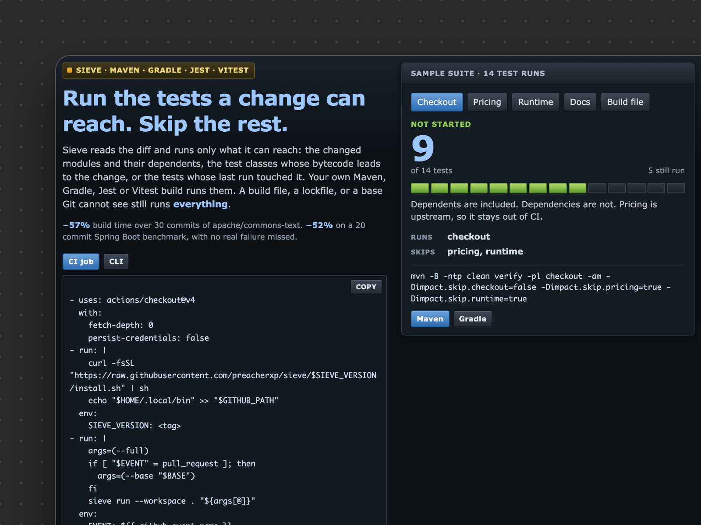
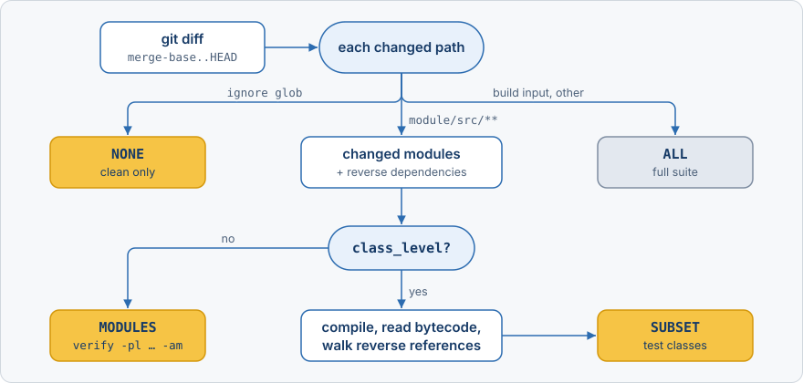
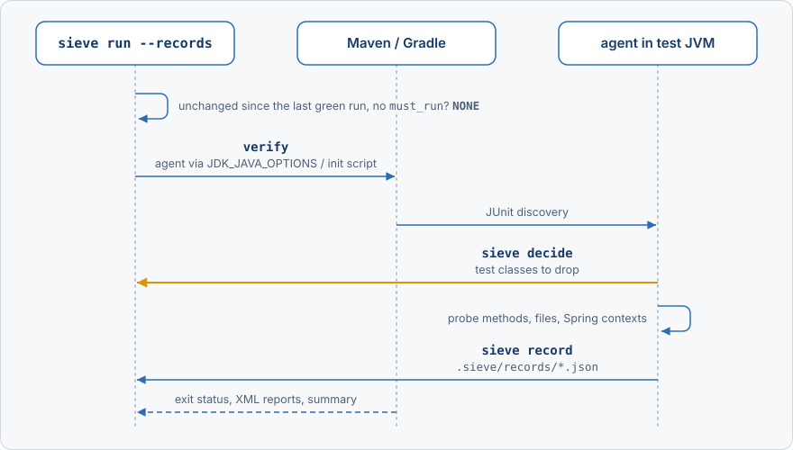
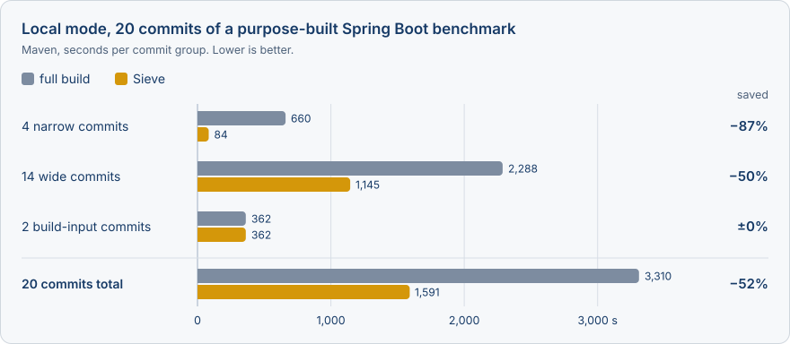
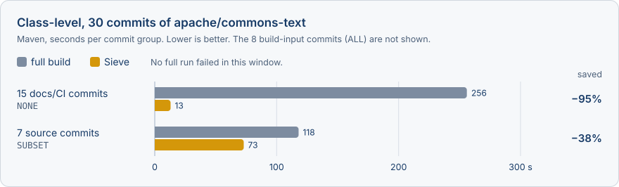
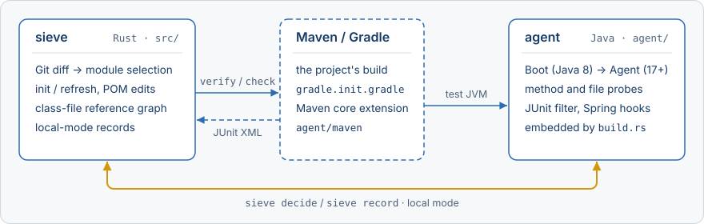

<p align="center"></p>

<p align="center">Run only the tests a change can affect. When unsure, run them all.</p>

<p align="center"><a href="https://preacherxp.github.io/30-days-of-tools/"></a></p>

<p align="center"><a href="https://buymeacoffee.com/michal.hachula"></a></p>

Sieve is a Rust CLI for Java and Kotlin/JVM projects built with Maven or Gradle, and for JavaScript and TypeScript projects tested with Jest or Vitest. It reads the Git diff, decides which modules, test classes or test files a change can reach, and runs them through the project's own build. Selection is conservative: build-script edits, unknown paths, or missing Git history select the full suite. A Maven POM edit that only bumps dependencies runs the modules whose effective dependencies changed.

<p align="center"></p>

## Requirements

- A Java or Kotlin/JVM project built with Maven or Gradle, or a JavaScript or TypeScript project tested with Jest or Vitest, in a Git repository
- For local mode: a single-module Maven or Gradle project whose test JVM runs Java 17+
- Linux x86_64 or arm64, or macOS on Apple silicon, for the prebuilt binary
- Rust 1.92+ and a JDK 17+ `javac` (for the embedded agent) to build from source

## Install

Prebuilt binary:

```sh
curl -fsSL https://raw.githubusercontent.com/preacherxp/sieve/master/install.sh | sh
```

From source:

```sh
cargo install --git https://github.com/preacherxp/sieve --locked
```

The installer fetches the latest release, verifies its checksum and puts `sieve` in `~/.local/bin`; set `SIEVE_INSTALL_DIR` to change the folder, or `SIEVE_VERSION=v0.3.0` to pin a release. The latest release is v0.3.0. Jest and Vitest support, and everything listed in [New since 0.3.0](#new-since-030), is on `master` only until the next release: install from source to use it.

To update, run the same command again. To uninstall, delete `~/.local/bin/sieve` (or run `cargo uninstall sieve`) and `impact.json`. If `init` added `skipTests` properties to your POMs (v0.3.0 always does on Maven; `master` only for builds that load their own `maven.ext.class.path`), remove those too.

## Usage

```sh
sieve init                              # detects Maven, Gradle, Jest or Vitest, writes impact.json
```

`init` writes `impact.json` (module graph or source roots, ignore globs, options) and refuses to overwrite an existing one. On `master` it edits no build file: the embedded Maven extension and a bundled Gradle init script do the work, and only a Maven build that loads its own `maven.ext.class.path` gets skip properties in its POMs. The v0.3.0 release adds per-module `skipTests` properties to every Maven module's POM. Commit `impact.json`, and any POM changes `init` reports. Run `sieve refresh` after build changes; until then, each module selection first checks the graph with the build, and selects everything if the graph changed.

Module selection is the default. On a single-module service, a source change still runs every test in that module. To evaluate selection within it, add `"class_level": true` to `impact.json`; [review its limits](docs/reference.md#class-level-selection) and measure before adopting it. For developer-only runtime records, use explicit `sieve run --records` commands; keep `"records": true` out of shared CI configuration.

```sh
sieve select --base origin/main         # preview the decision, no build
sieve run --base origin/main --output /tmp/selection.json -- -Pci
sieve run --full                        # always everything
```

Static execution defaults to Maven `clean verify` or Gradle `clean check`, scoped to the selected modules; on `master`, a selection of `NONE` starts no build at all. Use repeated `--task` options to retain your existing native goals and task dependencies, including packaging and report tasks when no tests are selected. Applicable build flags go after `--`.

```sh
sieve run --base origin/main --task check --task integrationTest --task jacocoTestReport
sieve run --base origin/main --observe --output /tmp/shadow.json
```

`--observe` (which needs `--output`) runs the full native task graph once and reports failures outside the proposed selection. Add `"must_run": ["com.example.Contract*Test"]` to `impact.json` for checks that should always join a selection. [Execution receipts](docs/reference.md#execution-receipts) let a later run skip verified successful tests at identical inputs.

## Evaluate on your history

Keep the existing full-suite check while comparing recent commits in the same JDK, profiles, and dependency environment as CI:

```sh
sieve replay --workspace . --commits 20 --run --output /tmp/sieve-replay.json
```

The terminal report and `/tmp/sieve-replay.json.md` show measured build wall time, selection modes and full-suite reasons, missed or selected-only failures, and inconclusive comparisons; JSON and build logs remain available for inspection. Savings require usable pairs with matching failure outcomes. Review the report even after a successful exit. A history with no failing full runs provides no evidence of catching real failures; `--run --plant` adds that evidence by planting a bug in each commit's changed main code, and a planted bug the selection misses fails the replay. Keep output outside the workspace or in an ignored directory so it cannot affect selection.

Use the [pilot checklist](docs/reference.md#pilot-checklist) to compare three teams' setup effort, PR feedback time, and continued use after a month. Local developer evaluation has a [separate guide](docs/local-mode-adoption.md).

## How it works



Three selection paths share one `Selection` type and one build runner:

| Path | Opt-in | Evidence | Picks | Best for |
|---|---|---|---|---|
| Module-level | default | Git diff + declared module graph | modules | multi-module CI |
| Class-level | `"class_level": true` | bytecode of the compiled revision | test classes | single-module CI, Spring apps |
| Local mode | `run --records` | what each test executed and read last time | test classes | developer machines |

**Module-level** follows the graph in `impact.json` and runs `verify -pl <selected> -am` (Maven, where the embedded extension skips the tests of the upstream modules `-am` adds) or `:<module>:check` (Gradle). A test-only change stays in its module unless another module uses its tests (`shared_tests`, found by `init`).

**Class-level** reads the selected modules' class files inside the build, once they compile, and walks reverse references through constant pools, supertypes, string-named classes, and Kotlin inline maps. Changed DI components, recognised by their annotations or supertypes, select every context test; Spring Boot slices narrow that. A source whose only edits are comments, Javadoc or formatting changes no class. Anything it cannot map (deleted sources, resources, unreadable classes) falls back to the module selection.

**Local mode** loads a Java agent into the test JVM. It records every project method and workspace file each test class touched, and on the next run drops classes whose records are unchanged. Spring wiring and `application.yml` keys are compared per member and per key, and a dependency bump reruns only the tests that ran code of the bumped jar, so most edits rerun only the tests that executed them.



## JavaScript and TypeScript

On `master`, `sieve init` on a project with no Maven or Gradle build finds its Jest or Vitest configuration and source roots (`--tool jest` or `--tool vitest` picks one). An edited script selects the test files that import it, directly or not. A script that a runner-loaded file imports (setup files, global setup, environments, transforms), and anything outside the source roots, such as `package.json`, lockfiles, `tsconfig.json` or the runner configuration, selects every test. `run` executes `jest --runTestsByPath FILES` or `vitest run FILES`. Local mode, class level, observation, receipts and `--task` are for Maven and Gradle only. See [the reference](docs/reference.md#javascript-and-typescript-jest-vitest).

## Measured

Twenty commits of a purpose-built Spring Boot benchmark with Testcontainers (62 test classes, 233 tests), replayed in local mode with `sieve replay --walk --plant`, seconds per commit kind, Maven. Planted bugs were caught in 11 commits on each tool, and no real failure was missed.



Total: 3,310 s to 1,591 s (-52%); Gradle shows -54%.

Thirty first-parent commits of `apache/commons-text` (103 test classes), class-level, `sieve replay --run`, 511 s to 222 s in total (−57%; no failing full runs in this window):



Class-level selection picks test classes inside the build that runs them, between compiling and testing: Gradle through the init script, Maven through a Sieve core extension. On a single-module Maven sample, a change that one of two tests reaches took 1.5 s, against 7.5 s natively when the other test has a 6 s setup and 1.4 s when it has none.

Full data, machines, and caveats: [docs/performance.md](docs/performance.md).

## New since 0.3.0

On `master`, not yet released:

- **`init` edits no POM.** The embedded Maven extension skips the tests of the upstream modules `-am` builds, so `impact.json` is the only file to commit.
- **No build for `NONE`.** A docs or CI only change no longer starts Maven or Gradle just to clean, which cost 1 to 3 s per commit.
- **Comment edits select nothing.** Javadoc, comment and formatting changes change no class; on commons-text they had selected 39 and 64 of its 103 test classes.
- **Gradle keeps its cache and daemon.** An identical class selection restores `:test` from the build cache, and the project's `org.gradle.daemon` setting decides whether a daemon runs.
- **Faster class-level analysis.** Class files are parsed on every core: 47,000 classes from real jars in 1.3 s instead of 6.3 s.
- **Fewer context-test reruns.** A helper that only calls a framework API is no longer treated as a DI component.
- **Planted bugs in every replay.** `replay --run --plant` now works for module and class-level selection, not just local-mode walks.
- **Jest and Vitest.** See [JavaScript and TypeScript](#javascript-and-typescript).
- **Local-mode safety.** Tests that scan classes (ArchUnit, ClassGraph, Spring's scanner) always run, and jars that change without a build edit, such as a republished SNAPSHOT, rerun the tests that used them.

## CI

Use module or class selection in consumer CI. Run `init` once in the CI build environment, review and commit its changes, and retain required full-suite validation during rollout. Preserve the existing JDK setup, caches, permissions, and report uploads. Pull requests select against the base; everything else runs the full suite.

```yaml
- uses: actions/checkout@v4
  with: { fetch-depth: 0, persist-credentials: false }
- shell: bash
  run: |
    curl -fsSL "https://raw.githubusercontent.com/preacherxp/sieve/$SIEVE_VERSION/install.sh" | sh
    echo "$HOME/.local/bin" >> "$GITHUB_PATH"
  env:
    SIEVE_VERSION: <verified-release-tag>
- shell: bash
  run: |
    args=()
    if [ "$EVENT" = pull_request ]; then args=(--base "$BASE"); else args=(--full); fi
    sieve run --workspace . "${args[@]}" --output "$RUNNER_TEMP/selection.json"
  env:
    EVENT: ${{ github.event_name }}
    BASE: ${{ github.event.pull_request.base.sha }}
```

The installer checks the release checksum and needs neither Rust nor a JDK. Runners without a prebuilt binary, or that need a change from `master`, can use `cargo install --git https://github.com/preacherxp/sieve --locked --rev <verified-commit-sha>` instead, with Rust 1.92+ and JDK 17+ `javac`.

Publish available selection JSON and native test reports with `if: always()`, guarding optional files. Missing Git history runs the full suite; build and test failures still fail the job. Local-mode records are for developer machines; `--ci` is experimental and is not supported for consumer CI rollout. See [the reference](docs/reference.md#records-in-ci).

## Limits

Static analysis cannot see classes named in resources outside `src/`, reflection on non-constant strings, or scanners it does not know. Records assume tests are independent and that passing runs covered their paths; undeclared environment, external services, and floating container tags are not tracked. Modules, nested or not, must sit in directories that match their place in the build. Workspace-local Gradle plugin-only included builds are supported; application composites, Android, and Multiplatform remain unsupported. Concurrent test classes share runtime evidence across overlapping executions; records still require a single module. JavaScript selection sees only literal `import` and `require` specifiers and runner-loaded files: scripts that tests spawn, read as fixtures, or import by a computed path are invisible, and type checking is not part of the selected run.

## Architecture



| Path | Contents |
|---|---|
| `src/` | CLI: `main.rs` (args, Git diff, module selection), `setup.rs` (init/refresh), `classes.rs` (class-level graph), `records.rs` (local mode), `replay.rs` (history replay), `js.rs` (Jest and Vitest), and the Gradle init script |
| `agent/` | Java agent, bootstrap probe, API stubs, vendored ASM, Maven extension (`agent/maven`) |
| `tests/` | Integration tests, among them `cli`, `setup`, `native`, `oracle`, `safety`, `records`, `replay`, `js`, `workflows` |
| `projects/` | Fixtures: `maven`/`gradle` parity pair, `single-*`, `records`, `records-reuse`, `version-bump`, `containers`, `js` (Jest and Vitest) |
| `samples/` | `bookstore`, `webshop` (5 Spring WebFlux services), `selective-performance`, `gradle-test-suites`, `runtime-plugins`, Kotlin: `kotlin-invoices` (Gradle), `kotlin-shipping` (Maven) |
| `scenarios.json` | Independent oracle for fixture mutations; the selector never reads it |
| `docs/adr/` | Decisions: runtime evidence, in-JVM selection, Gradle local mode, construction is not use, CI records, Maven class selection in the build, JavaScript selection through the runner |

Invariants: unknown change widens to `ALL`; build and test failures propagate; selection JSON is written before tests run; fixture expectations stay independent of selector code. Details in [ARCHITECTURE.md](ARCHITECTURE.md).

## Development

```sh
cargo fmt --check && cargo clippy --locked --all-targets -- -D warnings
cargo test --locked
cargo build --locked
target/debug/sieve fixtures verify --tool both --scenario all --selected
cargo test --locked --test records -- --include-ignored --test-threads=1   # Maven, Gradle, JDK 17+
cargo test --locked --test js -- --ignored                                  # Jest and Vitest, needs Node
```

## More

- [docs/reference.md](docs/reference.md): every flag, config key, fallback rule, and CI detail
- [ARCHITECTURE.md](ARCHITECTURE.md), [CONTEXT.md](CONTEXT.md), [docs/adr](docs/adr)
- [docs/performance.md](docs/performance.md), [docs/test-coverage.md](docs/test-coverage.md)
- [docs/local-mode-adoption.md](docs/local-mode-adoption.md)
- [site/guide.html](site/guide.html): browsable guide with diagrams

<sub>If it saves you some CI minutes, you can [buy me a coffee](https://buymeacoffee.com/michal.hachula).</sub>
